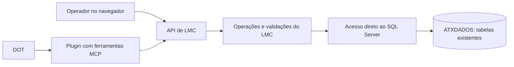

# Interface e integração com o DOT

Atualizado em 07/10/2026. Revisão de notas, consultas, prévias, gravação e exclusão de LMC implementadas. A versão 1.0.0 inclui pacote para serviço Windows em rede local, HTTPS e login configurado fora do SQL Server. A integração MCP permanece pendente. O sistema usa somente o banco do Xpert, preservando sua estrutura.

## Implementação atual

`src/Lmc.Web` é uma aplicação ASP.NET Core (.NET 10) que serve HTML, CSS e JavaScript locais e uma API JSON. O navegador não recebe credenciais SQL. O acesso usa consultas parametrizadas com [Microsoft.Data.SqlClient 7.1.1](https://www.nuget.org/packages/Microsoft.Data.SqlClient/7.1.1), com dependências fixadas em `packages.lock.json`. Não há ORM, migração ou criação de objetos. A correção usa UPDATE nas notas, movimentos e parcelas e INSERT no histórico já existente. A compatibilidade 100 do banco foi preservada.

O modo de desenvolvimento escuta em `127.0.0.1:5080` e recusa clientes fora do loopback. O pacote de produção exige configuração protegida, operadores com hash de senha, redes e hosts explícitos e HTTPS. Os operadores configurados possuem acesso às operações da interface; perfis distintos ainda não existem. A configuração fica fora do banco, protegida por DPAPI e ACLs do Windows. As respostas não ficam em cache e CORS não é habilitado. Veja [implantação em produção](producao.md).

| Rota | Operação atual |
| --- | --- |
| `GET /api/context` | Filiais com entradas, última data de LMC e capacidade de consulta/prévia |
| `GET /api/notes` | Busca, filtros, resumo e paginação das notas |
| `GET /api/notes/{filial}/{origem}/{documento}` | Datas, vínculos, parcelas e versão do conjunto |
| `GET /api/shifts?branch=...&date=...` | Turnos existentes da filial e data |
| `POST /api/notes/{filial}/{origem}/{documento}/preview` | Simulação sem escrita, com validação do destino e comparação da versão |
| `GET /api/books?branch=...&date=...` | Consulta de livros existentes da data |

O fluxo começa na revisão de notas, conforme a prioridade definida pelo usuário. A lista consulta e agrega as notas da filial em uma leitura e faz filtros/paginação no serviço; isso foi verificado com os 1.000 documentos desta cópia. A estratégia deverá ser medida e, se necessário, deslocada para paginação SQL antes de atender bases muito maiores. Não há cache compartilhado de notas ou armazenamento paralelo de correções.

A versão SHA-256 da projeção do documento e seus vínculos detecta mudanças relevantes à prévia. Ela **não substitui** a futura validação concorrente dentro da transação de gravação. A rota de aplicação valida a versão novamente dentro da transação, com histórico e token antifalsificação. Consulte [gravação de correções](correcao-gravacao.md).

Decisão confirmada pelo usuário: não criar tabelas nem modificar a estrutura existente. Consultas, inserções, atualizações e exclusões de registros fazem parte do escopo da aplicação. A restrição se aplica à estrutura, não à manutenção dos dados.

## Estrutura recomendada

A interface exibe os dados e permite revisão; a API concentra cálculos, autorização e operações. As ferramentas MCP reutilizam o mesmo serviço. Isso permite desenvolver a interface agora e automatizar o processo com o DOT sem duplicar regras.

A API dará suporte às ações da interface, incluindo conferência, preparação, gravação e emissão dos livros nas tabelas existentes. O aplicativo desktop Xpert não faz parte do fluxo. A decisão sobre aproveitar uma rotina já existente no banco ou implementar uma operação na API depende do mapeamento e da validação de seu comportamento. Os registros existentes serão usados para comparar resultados; suas regras internas não serão tratadas como autoridade normativa.

## Uso da estrutura existente

Usar as tabelas existentes de cadastros, movimentos, documentos e LMC. A proposta de schema e tabelas adicionais foi retirada. Não criar ou alterar tabelas, colunas, índices, constraints, procedimentos ou triggers. Cada dado consultado deverá ser identificado pela chave completa, incluindo filial e as demais partes da chave.

A restrição inclui adicionar ou remover campos e alterar nomes, tipos de dados, tamanhos, precisão, escala, nulabilidade ou valores padrão. A aplicação deverá se adaptar às definições existentes. A biblioteca de acesso ao banco não poderá criar objetos nem executar migrações ou sincronizações automáticas de estrutura. Inserir um registro significa preencher os campos existentes de uma nova linha; atualizar significa alterar seus valores, preservando as definições desses campos.

As tabelas existentes de LMC possuem triggers que podem executar automaticamente em um `INSERT`, `UPDATE` ou `DELETE` direto, sem abrir o Xpert. A implementação deverá validar os efeitos dessas triggers no ambiente de desenvolvimento, preservando os objetos existentes. Os procedimentos criptografados identificados ainda não tiveram seus efeitos mapeados; seu uso permanece uma decisão técnica pendente dessa validação. Nenhuma alteração de estrutura ou dados foi executada nesta etapa de levantamento.

A aplicação deverá aproveitar os registros existentes e evitar dupla contagem por filial, produto e data. Numeração, estados, histórico e controle de concorrência devem ser mapeados para os recursos já disponíveis, sem pressupor novas colunas ou tabelas de versões. Rascunhos e simulações podem ser calculados em memória. Ainda não foi definido um mecanismo de persistência de auditoria compatível com essa restrição.

As operações de criação, edição e exclusão deverão respeitar as chaves compostas, dependências entre cabeçalho e detalhes e efeitos das triggers. Uma operação de negócio deverá ser atômica e ter escopo explícito de filial e registros. Exclusão de um registro não autoriza deixar referências órfãs ou remover movimentos sem relação com ele. No caso de documentos fiscais, a aplicação deverá distinguir a manutenção de dados do cancelamento fiscal e mapear os estados existentes, sem tratar os dois conceitos como equivalentes.

A automação existente atualiza os encerrantes ao registrar as vendas, conforme esclarecimento do usuário. A aplicação consumirá essa alimentação no banco. Novos recebimentos e medições físicas terão suas fontes e fluxos mapeados separadamente, usando as integrações existentes ou o lançamento pela interface. O escopo se concentra nas operações do LMC.

O usuário informou o uso de outros protocolos ativos além do cenário TLS mencionado. A interface deverá comportar as diferentes integrações usadas pelos clientes. A API distinguirá medição física de tanques, automação de bombas/bicos e lançamento manual, com regras comuns para conferência. Os [dados inspecionados](medicoes-tanques.md#outras-integrações-e-protocolos) mostram configurações distintas de medidor e automação, mas os códigos dos modelos ainda não identificam seus protocolos. Conectores diretos só poderão ser definidos a partir desse mapeamento; nenhum protocolo será assumido a partir de um nome de campo ou endereço preenchido. Essa extensão se dará na aplicação, preservando a estrutura do banco.

Para os encerrantes de fechamento, `CONSOLEARQUIVO` é a principal fonte candidata para selecionar o último registro de cada bico dentro do período: seus valores coincidem com os 540 fechamentos comparados ao agrupar por `DATA`. `ENCERRANTESTURNOS` será usada na conferência; seus valores coincidem em 538 casos, e os dois restantes correspondem a abastecimentos após a meia-noite. A automação já fornece os dados. O serviço deverá validar corte, estados, empates, cobertura e abertura antes de preparar o livro. Não está previsto outro coletor de encerrantes nesta etapa. Ver [evidências e fluxo de consulta](encerrantes-fechamento.md#validação-de-consolearquivo).

A OpenAI documenta [servidores MCP para expor dados e ações controladas](https://developers.openai.com/plugins/build/mcp-server). A [documentação do DOT](https://learn.chatgpt.com/docs/dots/computers-and-apps) informa que ele pode usar plugins compatíveis e coordenar tarefas em um computador conectado. Disponibilidade e permissões do plugin específico precisam ser testadas na conta de destino.

## Execução local

Inicialmente, a aplicação pode funcionar no computador que acessa o SQL Server. O navegador acessa a aplicação; somente o serviço acessa o banco. Para o DOT usar recursos dessa máquina pela conexão local, ela deve estar online e com o aplicativo ChatGPT aberto, conforme a documentação acima. Acesso ao computador pelo DOT deve ser concedido separadamente; estar conectado ao Codex não concede esse acesso automaticamente.

Uma implantação posterior pode hospedar o serviço em máquina disponível continuamente e configurar uma conexão autenticada ao MCP. A forma de conexão deve ser validada para o ambiente do DOT; um endereço `localhost` na máquina dele não aponta para o SQL Server deste computador.

Não é necessário publicar o SQL Server na internet. A identidade do serviço terá as permissões de consulta e manutenção de dados necessárias nas tabelas utilizadas, sem permissões para mudar a estrutura. A conta administrativa usada no levantamento não será a identidade da aplicação.

## Operações propostas

| Ferramenta futura | Finalidade | Efeito |
| --- | --- | --- |
| `consultar_lmc` | Ler filial, período, produtos e detalhes | Leitura |
| `verificar_inconsistencias` | Produzir achados com regra e evidências | Leitura |
| `conferir_datas_entradas` | Localizar notas com datas ou turnos suspeitos, inclusive fora do período operacional pesquisado, informando evidências e lacunas | Leitura |
| `preparar_lmc` | Construir prévia com base nos dados disponíveis | Simulação em memória, sem escrita no banco |
| `simular_correcao` | Mostrar impacto e dias afetados | Simulação |
| `simular_troca_turno_entrada` | Comparar data/turno atuais e de destino de uma nota de entrada e listar os efeitos | Simulação |
| `trocar_turno_entrada` | Aplicar a nova data operacional e turno da entrada e revisar os LMCs afetados | Atualização nas tabelas existentes |
| `registrar_justificativa` | Vincular causa e evidência à ocorrência | Escrita em campos existentes a mapear |
| `gravar_lmc` | Persistir os dados validados nas tabelas existentes de LMC | Inserção ou atualização conforme a operação |
| `excluir_registro` | Excluir registros selecionados no contexto de uma operação de negócio | Exclusão com validação de dependências e escopo |
| `exportar_lmc` | Gerar documento no modelo validado | Arquivo |

O resultado da conferência deverá trazer: filial, produto, data, identificador da regra, gravidade, registros de origem, esperado, encontrado, diferença, unidade e sugestão de investigação. Uma regra sem dados suficientes retorna `nao_avaliado`; zero achados em um conjunto parcial não significa conformidade.

Os alertas de perdas e sobras seguirão o [fluxo de conferência e sugestões de correção](regras-lmc.md#alertas-de-perdas-e-sobras-e-sugestões-de-correção). A API deverá distinguir valores medidos, resultados calculados e simulações. Sugestões de alteração precisarão identificar a origem da correção; a faixa de referência não poderá alimentar automaticamente os campos de medição. A igualdade entre estoque físico e escritural não será impedida nem substituída por variações artificiais.

As permissões do DOT serão definidas por operação. A aplicação deve controlar autorização, concorrência e rastreabilidade independentemente das instruções dadas ao agente e sem alterar a estrutura do banco. Repetir uma solicitação de gravação não poderá duplicar o livro. Alterações nos dados de origem após uma prévia devem invalidar aquela prévia antes de gravar. A forma de preservar o histórico ainda precisa ser mapeada para os recursos disponíveis.

## Sequência de implementação

1. Tela de revisão de notas antes do LMC, usando os dados existentes para validar o mapeamento (consulta e prévia já implementadas).
2. Validar gravação das correções de data/turno e ampliar a conferência e os cálculos do LMC, com casos de referência derivados dos registros e das regras documentadas.
3. Implementar consulta, inserção, atualização e exclusão nas tabelas existentes, validando transações, dependências, concorrência, numeração e efeitos das triggers. Não introduzir migrações de estrutura.
4. Ferramentas MCP e operação pelo DOT, com a política de autonomia definida para cada ação.

Tecnologia adotada para a API: ASP.NET Core, aproveitando o SDK .NET 10 instalado e a integração com SQL Server/Windows. A biblioteca de acesso é Microsoft.Data.SqlClient 7.1.1; a escolha do SDK MCP fica para a implementação dessa integração.

O [fluxo de notas de entrada e troca de turno](notas-entrada-turnos.md) detalha a operação solicitada pelo usuário. Ela deve tratar a nota, os movimentos associados e as parcelas por tanque como uma única operação de negócio; mudar apenas o campo de turno do cabeçalho não é suficiente para garantir consistência.

A mudança para outra data operacional foi confirmada pelo usuário. A seleção do destino inclui filial, data e identificador de turno; o serviço deve validar que correspondem entre si e calcular os efeitos nos dias de origem/destino e nos saldos posteriores dependentes.

A conferência de notas deverá distinguir emissão, recebimento físico, data operacional e digitação quando esta for conhecida. O prazo de transporte vindo de Manaus orienta a triagem, sem determinar automaticamente a data da entrada. A busca deve alcançar notas deslocadas para outros dias ou meses; a correção será acessível na própria lista. A investigação encontrou documentos com intervalos entre campos de 5, 9 e 21 dias e um vínculo comum ao turno 1 cujo significado está pendente. Esses achados e os critérios de aceite estão no [fluxo de notas](notas-entrada-turnos.md#tela-de-conferência-de-notas-de-entrada).
